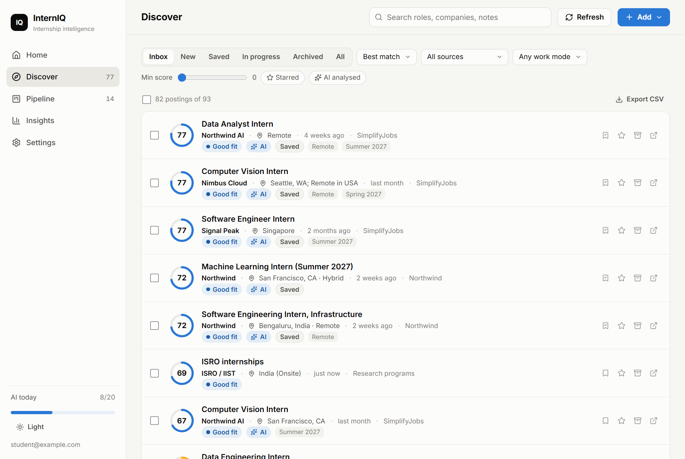
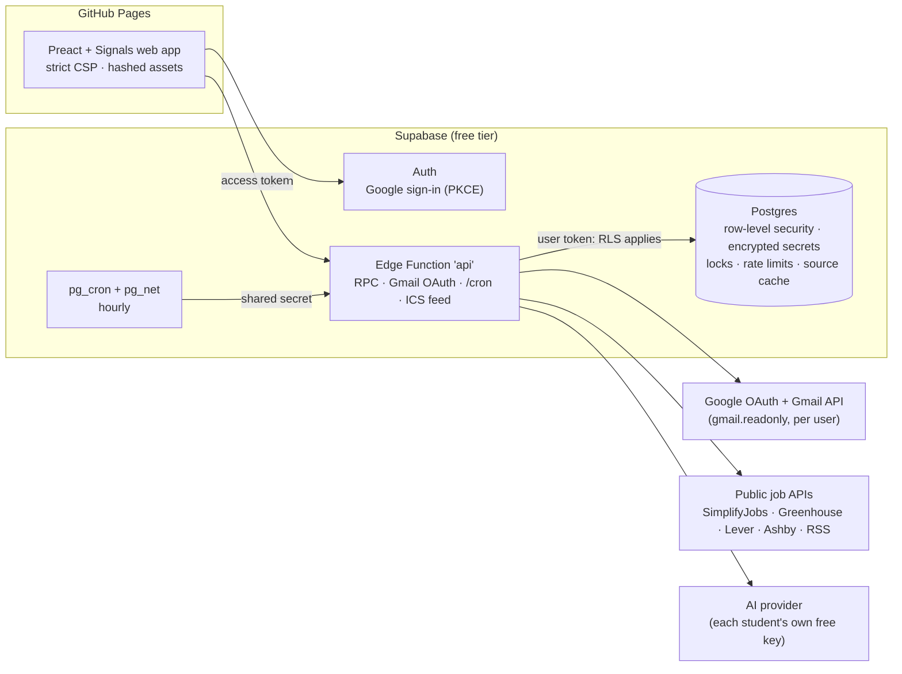

# InternIQ: Internship Intelligence Platform

One tracker for a student's whole final year: **internships** matched to your skills, your **application pipeline**, funded **master's and PhD programmes** abroad, **Indian government exams**, and every deadline on **one calendar**, with optional **Gmail** tracking that turns placement emails into updates and tasks. Free for students, private by design, and built to be shared with your batch.


-8E75B2)


<p align="center">
  
</p>

| Discover | Pipeline | Insights |
| :---: | :---: | :---: |
|  |  |  |

---

## What's new in v3

v2 ran on Google Apps Script, one spreadsheet per user. v3 is a proper multi-user web app you can send to your batchmates and juniors:

|  | v2 (Apps Script) | v3 |
|---|---|---|
| Sign-in | Google account via Apps Script, "unverified app" screen for everyone | **Continue with Google** (basic profile only, no warning) |
| Database | A Google Sheet per user | **Postgres** (Supabase), one schema, **row-level security** isolating every user's rows |
| Secrets | Apps Script user properties | AI keys and Gmail tokens **encrypted** (AES-256-GCM) in tables no client role can read |
| Gmail | Personal build only | **Every student, optional**: connect read-only Gmail in one click, disconnect any time |
| Background work | Per-user Apps Script triggers | One **hourly cron** fanning out per user; shared cache for big public feeds |
| Calendar | `.ics` download | Plus a **private live feed** to subscribe to in Google or Apple Calendar |
| Hosting | script.google.com URL | Your own URL on GitHub Pages; a real landing page, privacy policy and terms |
| Operations | none | **Owner dashboard**: sign-ups, active users, suspend abuse, automation status |
| Your data | Sheet in Drive | **Export everything** as JSON, **delete account** (cascades every row, revokes Gmail) |

## Features

- **Calendar.** Month grid and agenda across internships, studies, exams and tasks, colour-coded by area, with quick-add, overdue tasks, Google Calendar links, `.ics` export and a private subscription feed.
- **Mail (optional).** Hourly, read-only Gmail scan: college placement cell / POD notices, application confirmations, assessments, interviews, offers and rejections move your applications along the pipeline (never backwards); deadlines and interview times become calendar tasks; job alerts, OTPs and paid "training programs" are filtered out. Admissions and exam emails are routed to their sections. Only short extracts are stored.
- **Further studies.** 123 researched master's programmes (Erasmus Mundus, UAE & Gulf, Germany) with deadlines, funding and requirements, a stage pipeline, per-programme document checklist and an application roadmap. 20 funded research internships abroad are importable into the internship pipeline.
- **Government exams.** 24 exams worth tracking for a final-year B.Tech (UPSC CSE/CDS/CAPF/ESE, AFCAT, Army TGC, Navy SSC IT, SSC CGL/CHSL/CPO, DSSSB, RBI, SEBI, IBPS, GATE, UGC NET, ISRO, DRDO, NIELIT…) with eligibility notes, dated milestones marked official / expected / watch, and your own status and registration numbers.

### Internships
- **Discover.** Fresh internships from the community SimplifyJobs list and the public job boards of companies you follow (Greenhouse, Lever, Ashby), plus optional Hacker News and We Work Remotely feeds. De-duplicated, filtered to internships, newest first.
- **Free match scores on every posting.** Skills (40%), role fit (25%), eligibility (20%) and location (15%), with strengths, gaps, tips and eligibility flags. No key, no quota.
- **AI analysis (optional, free).** Paste a free Gemini, Groq or OpenRouter key. Promising jobs are analysed within a daily budget you set, five per request.
- **Cover letters.** Written only from facts in your résumé; without AI you get an honest template.
- **Pipeline and insights.** Drag-and-drop kanban with deadlines and follow-ups; funnel, weekly applications, score distribution and best sources.
- **Polished UI.** Light/dark themes, responsive down to phones, accessible dialogs, optimistic updates with undo.

## Architecture



Key decisions:

- **Isolation in the database, not just the app.** API requests reach Postgres with the student's own token, so row-level security limits every query to their rows even if application code had a bug. Secrets sit in tables with no client policies at all, encrypted with a key only the server holds.
- **One request, one context.** The edge function serves many users concurrently; per-request state lives in `AsyncLocalStorage`, verified at startup (requests are serialised if a runtime ever broke it).
- **Free first, AI second.** A deterministic matcher scores everything instantly. AI is spent on the most promising jobs, in batches, under a daily cap.
- **Shared where it is public, private where it is personal.** Big public feeds are fetched once and cached for everyone; everything personal is per user. Old untouched postings are pruned so the free database tier lasts.
- **Network outside the lock, merge inside it.** Long fetches and AI calls run unlocked; results merge onto a fresh read under a per-user lease lock.
- **Server-side request forgery guard.** Every user-supplied URL (and every redirect hop) is checked against private and internal addresses, with size and time caps.

## Getting started

### Use it

Open the link you were sent, **Continue with Google**, and the onboarding takes about two minutes: profile, AI engine (free matcher, or paste a free [Gemini key](https://aistudio.google.com/app/apikey)), sources, done. Connect Gmail from the Mail tab if you want inbox tracking.

### Run your own

Everything runs on free tiers. See **[docs/DEPLOY.md](docs/DEPLOY.md)**; in short: create a Supabase project and a Google OAuth client, then

```bash
npm ci
npx supabase login
npm run setup      # links the project, creates tables, stores secrets, deploys the API
git push           # GitHub Pages publishes the web app
```

### Develop locally

```bash
npm run dev:demo   # http://localhost:5178: demo data, fake Gmail and AI, simulated sign-in
npm run dev        # empty account, shows onboarding
```

The dev server runs the real API code on PGlite (Postgres compiled to WebAssembly) with the real migrations and row-level security. Add `?signedout` to see the landing page.

### Test

```bash
npm run check      # typecheck (server, client, tests) + tests + production build
```

The tests run the real migration on Postgres (PGlite) and drive the real HTTP handler: sign-in and CORS, cross-user isolation, row-level security and least-privilege grants, encrypted secrets, the refresh pipeline and shared cache, SSRF guards, AI batching and quota backoff, the Gmail OAuth flow and inbox triage, the hourly worker and cron fan-out, calendar feeds, the owner dashboard, rate limits, export and account deletion. Plus the matcher, every source parser, imports, prompts and the build artefacts.

## Project structure

```
src/
  shared/            types + RPC contract, free matcher, skills, calendar, text utils, defaults
  server/            API (bundled to supabase/functions/api/index.ts)
    edge/            HTTP handler (RPC, Gmail callback, cron, ICS) and the Deno entry
    platform/        request context, Postgres port (PostgREST / PGlite), auth, crypto, HTTP + SSRF guard
    api.ts           RPC handlers with input validation
    rpc.ts           method table and rate limits
    pipeline.ts      refresh + AI queue
    sources/         SimplifyJobs, Greenhouse, Lever, Ashby, RSS, job-page extraction
    ai/              provider clients, prompts, output validation
    mail/            Gmail OAuth + REST client, classifier, inbox sync
    store/           tables, session, per-user state, jobs, studies/exams/tasks
    automation.ts    hourly worker
  client/            Preact UI, landing page, privacy and terms pages
supabase/
  migrations/        schema, row-level security, SQL functions, cron
scripts/             build, dev server, setup, deploy
tools/               test harness, PGlite database, fixtures
tests/               vitest suites
```

## Privacy

Each account can only read its own data; AI keys and Gmail tokens are encrypted; Gmail is optional, read-only and revocable; students can export or delete everything. The full policy ships with the app as `privacy.html`.

## Author

**Dhruv Basia** · [@DhruvBasia](https://github.com/DhruvBasia)

## License

[MIT](LICENSE)
