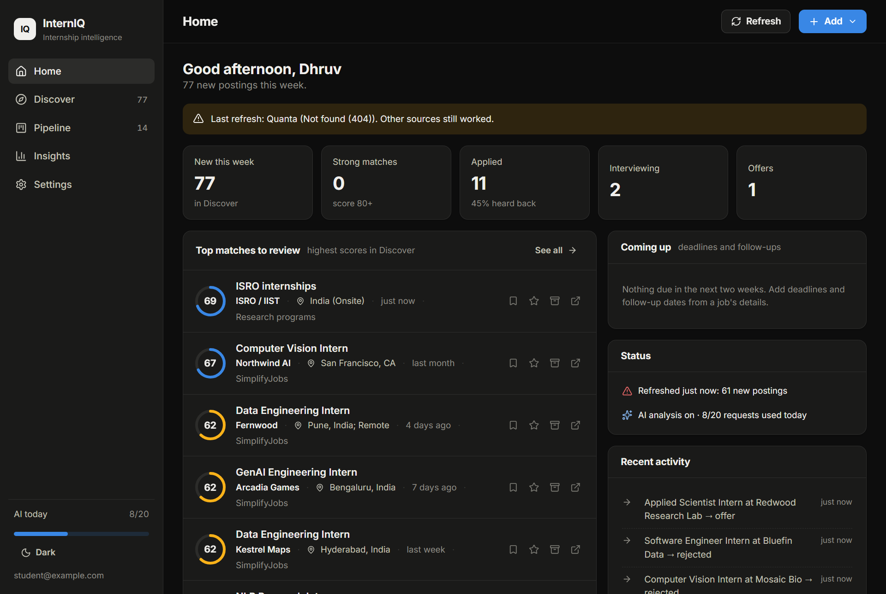
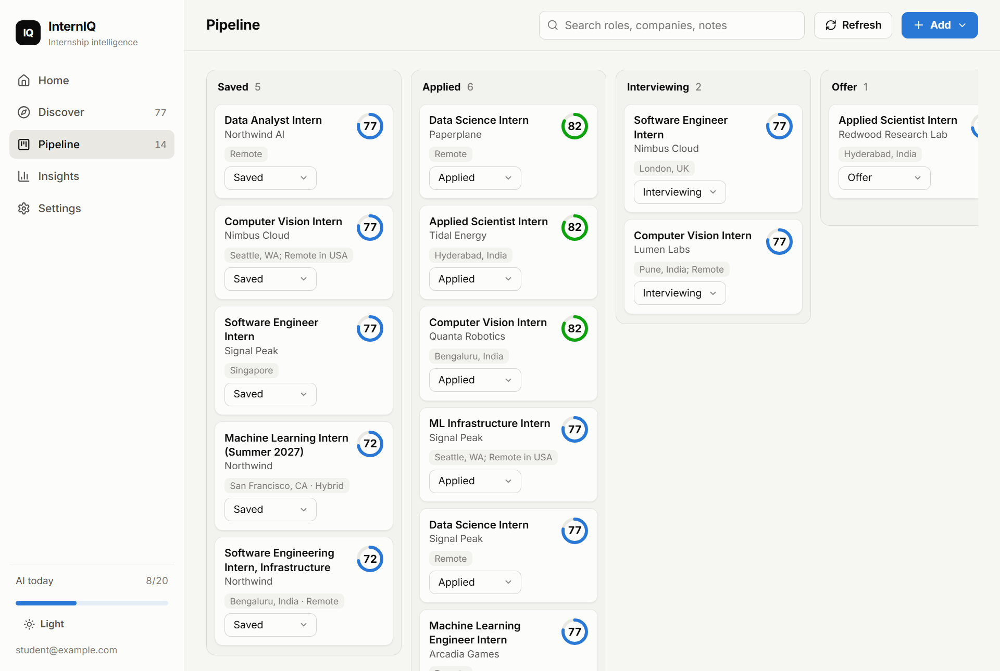
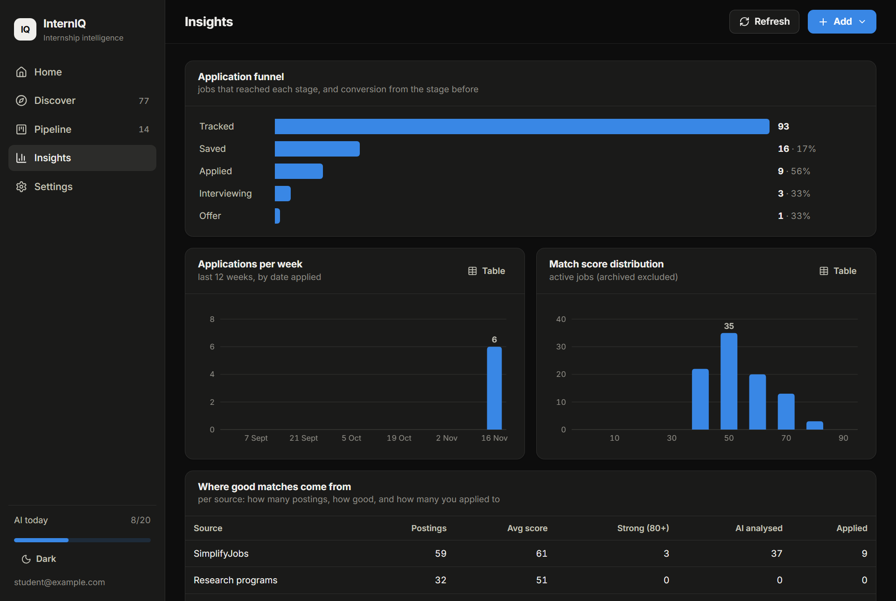
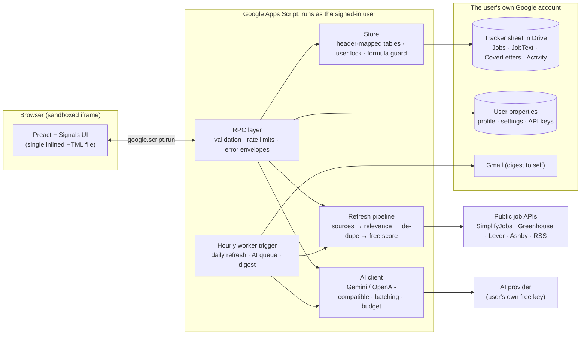

# InternIQ: Internship Intelligence Platform

Find internships that actually fit you. InternIQ pulls fresh internships from SimplifyJobs and the companies you follow, scores every one against your skills, goals and eligibility, and tracks your applications from saved to offer. It's free for every student, private by design, and runs on Google Apps Script.


-8E75B2)


<p align="center">
  
</p>

| Discover | Pipeline | Insights |
| :---: | :---: | :---: |
|  |  |  |

---

## Why v2

v1 was a single-user Apps Script app. v2 is a rebuild for real use by many students:

|  | v1 | v2 |
|---|---|---|
| Users | Only the deployer | Anyone with a Google account; each runs as themselves |
| Data | One sheet, read in full on every click | Lean `Jobs` sheet plus on-demand `JobText`, batched writes, per-user locking |
| Scoring | One opaque Gemini number; failures saved as 0 | Free 4-dimension matcher on every job, plus optional AI with strict JSON, clamping, retries and budgets |
| AI cost | Owner's key | Bring-your-own **free** key (Gemini / Groq / OpenRouter), batched 5 jobs per request |
| Sources | Hard-coded Summer 2026 list; two dead RSS feeds | Season-aware SimplifyJobs, follow any Greenhouse/Lever/Ashby company, HN, WWR, any job URL |
| Security | Key in URL query, `ALLOWALL` framing, unescaped scraped HTML in UI and email | Key in header, default framing, escaped rendering everywhere, formula-injection guard, http(s)-only links |
| Permissions | Full Gmail + full Drive | Spreadsheets, send-mail-as-you, triggers, URL fetch, email address |
| Engineering | Hand-copied `.gs` files, no tests | TypeScript, esbuild, 67 tests (including end-to-end runs of the built bundle), CI, local dev harness |

## Features

- **Discover.** Fresh internships from the community SimplifyJobs list (thousands of live postings) and the public job boards of companies you follow (Greenhouse, Lever, Ashby), plus optional Hacker News and We Work Remotely feeds. Season-aware, de-duplicated by canonical URL and by company+role, filtered to internships, newest first.
- **Free match scores on every posting.** Skills (40%), role fit (25%), eligibility (20%) and location (15%), with plain-language strengths, gaps, tips and **eligibility flags**: PhD-only roles, senior titles, graduation windows, and "U.S. citizenship required" for students who need sponsorship. No key, no quota.
- **AI analysis (optional, free).** Paste a free Gemini, Groq or OpenRouter key. Promising jobs are analysed automatically within a daily budget you set, five per request so free tiers go further. Title-only postings are enriched with the full description first.
- **Cover letters.** Tone and length options, written only from facts in your resume (the prompt forbids invented projects or numbers). Without AI you get an honest fill-in-the-blanks template.
- **Pipeline.** Drag-and-drop kanban (Saved → Applied → Interviewing → Offer / Rejected) with keyboard and mobile fallbacks, deadlines, follow-up reminders and one-click Google Calendar events.
- **Insights.** Application funnel with stage conversion, applications per week, score distribution, and which sources produce your best matches. Every chart has a table view.
- **Automation.** An optional daily refresh at your local hour, AI queue draining in later hours, and a daily email digest of new strong matches, all running even when the tab is closed.
- **Your data, your sheet.** Everything lives in a Google Sheet in your Drive, with CSV import/export, import from any Google Sheet (including v1), a 32-programme research-internship pack (ETH SSRF, Mitacs, MBZUAI, IISc, IITs, MSR India…), and one-click delete-everything.
- **Polished UI.** Light/dark themes, responsive down to phones, accessible dialogs (focus trap, Escape, labels), optimistic updates with undo, skeleton loading and toasts.

## Architecture



Key decisions:

- **Execute as the user accessing the app.** Data isolation comes from Google's own account boundaries, not from app logic. Quotas are per user, so the app scales with its users at zero cost.
- **Free first, AI second.** A deterministic matcher scores everything instantly. AI is spent only on the most promising jobs, in batches, under a daily cap, with cooldowns when a provider says slow down. Failures never overwrite scores.
- **Network outside the lock, merge inside it.** Long fetches and AI calls run unlocked; results are merged onto a fresh read under the user lock, so a background refresh never clobbers an edit made in the UI.
- **The sheet is a real database, carefully.** Columns are found by header (users can reorder or add their own), heavy text lives in a separate sheet, writes are batched, and every value that could be read as a formula (`=`, `+`, `-`, `@`) is forced to text.

## Getting started

### Use it

Open the deployment link, sign in with Google, and the onboarding wizard takes about two minutes: profile, AI engine (free matcher, or paste a free [Gemini key](https://aistudio.google.com/app/apikey)), sources, done.

### Deploy your own

See **[docs/DEPLOY.md](docs/DEPLOY.md)**. In short:

```bash
npm install
npm install -g @google/clasp && clasp login
clasp create-script --type webapp --title "InternIQ" --rootDir dist
npm run deploy
```

### Develop locally

The dev harness runs the **real server bundle** in Node against in-memory fakes of the Apps Script services, and serves the real UI with a `google.script.run` shim. No Google account or deploy is needed.

```bash
npm run dev          # offline fixtures, empty account → onboarding
npm run dev:demo     # pre-filled profile, refreshed jobs, pipeline history
npm run dev:live     # real job sources (and your real AI key if you add one)
```

Then open <http://localhost:5178>. Deep links like `?view=insights&theme=dark` work locally.

### Test

```bash
npm run check        # typecheck (server, client, tests) + 67 tests + production build
```

The tests cover the matcher, every source parser, CSV/TSV import, prompt construction and output validation, digest escaping, and end-to-end runs of the built `Code.js` against the fakes. Those runs cover first-run setup, refresh and de-duplication, formula-injection safety, CRUD and validation, AI batching, key handling, quota backoff and budgets, triggers and digest, v1 in-place migration, rate limiting, and delete-everything.

## Project structure

```
src/
  shared/          types + RPC contract, free matcher, skills dictionary, text utils, defaults
  server/          Apps Script code (bundled to dist/Code.js)
    main.ts        entry: doGet, RPC exports, triggers
    api.ts         RPC handlers with input validation
    pipeline.ts    refresh + AI queue
    sources/       SimplifyJobs, Greenhouse, Lever, Ashby, RSS, job-page extraction
    ai/            provider clients, prompts, output validation
    store/         sheet tables, per-user state, jobs repository
    migrate.ts     v1 upgrade and sheet import
    automation.ts  hourly worker, digest
  client/          Preact UI (bundled and inlined into dist/index.html)
scripts/           build, dev harness, deploy
tools/             Apps Script fakes and network fixtures (dev + tests)
tests/             vitest suites
```

## Upgrading from v1

Push v2 into the same Apps Script project (see [DEPLOY.md](docs/DEPLOY.md#2-create-or-connect-the-apps-script-project)). On first open, InternIQ converts the v1 `Internships` sheet, carries over cover letters, profile and Gemini key, keeps the old sheets as `v1 backup · …`, and retires the old daily trigger. Anyone can also import a v1 sheet from **Add → Import → Import from a Google Sheet**.

The v1 launch video and release remain at [v1.0.0](https://github.com/DhruvBasia/internship-intelligence-platform/releases/tag/v1.0.0).

## Privacy

InternIQ runs as each user inside their own Google account; the deployer can't see anyone's data. Details: [PRIVACY.md](PRIVACY.md).

## Author

**Dhruv Basia** · [@DhruvBasia](https://github.com/DhruvBasia)

## License

[MIT](LICENSE)
